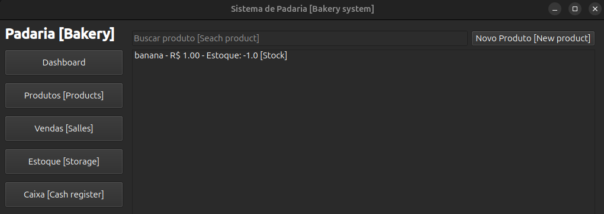

# Sistema de Padaria usando Guará

# Instalação [Installation]
```bash
python3.11 -m venv venv
source venv/bin/activate
pip install -r requirements.txt -r test-requirements.txt
PYTHONPATH=$(pwd) python scripts/create_database.py
```

**Dica [Tip]**: crie alguns dados no banco de dados para brincar com o sistema. [create some data in database to play with the system.]

Para rodar as migrações do banco de dados `alembic revision --autogenerate -m "create_initial_tables"` [To run the migration of database]

```bash
PYTHONPATH=$(pwd) python scripts/seed.py
python cli.py login --username gerente --secret qwerty123
```

# Inicialização UI [Initialization UI]
```bash
python app.py
```


# Inicialização CLI [Initialization CLI]
```bash
$ python cli.py --help
Usage: cli.py [OPTIONS] COMMAND [ARGS]...

  Sistema de Padaria usando Guará. [Bakery system]

Options:
  --help  Show this message and exit.

Commands:
  add-stock
  claude
  close-cash
  create-customer
  create-product
  create-user
  expiration-panel
  list-customers
  list-products
  list-sales
  list-users
  login
  low-stock
  open-cash
  pay
  recommend
  register-batch
  sangria
  sell
  update-price
```

# Testes [Tests]
```bash
python -m pytest
```